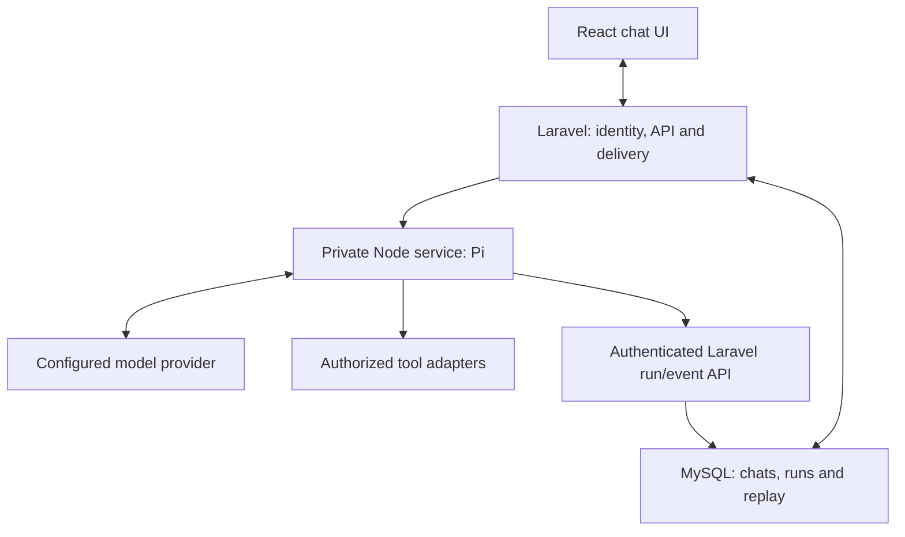

# Blueprint: Laravel Chatbot Foundation

Updated: 24 October 2026\
Revision: 14 — Reviewed provider connections and account credential cleanup published; live verification pending\
Status: Phase 2 is complete. Provider sign-in/key storage, connection selection, chat deletion and date sections are published to `main` and `development`. Account deletion disconnects owned provider credentials before removing the database account. Task 3.1 still needs real-account verification; chat replies remain simulated, and real model execution and durable runs remain. No provider or throughput benchmark has been produced.

Companion: [Build_Plan.md](Build_Plan.md). Follow its numbered tasks for implementation; this blueprint defines the architecture and acceptance requirements. The plan's checkboxes record implementation progress, not capabilities already delivered.

Continuation record: [handoff.md](handoff.md) states where work stopped, what was verified, the remaining work and how to resume task 3.1. Refresh it alongside the build plan after each implementation session.

## 1. Goal and agreed foundation

Build a fresh chatbot with Laravel, React, shadcn/ui and Lucide, retaining Pi as the AI engine. Use the architectural lessons in `Kairo_Capability.md`, `Kairo_Engine.md` and `structure.md`; give the new assistant its own identity, instructions, tools and purpose.

**Agreed stack: Laravel + Inertia + React + TypeScript + Tailwind CSS + shadcn/ui + Lucide + a private Node.js/Pi service + MySQL.**

**Development: Docker Compose with Laravel Sail, plus an explicit `agent` service for Pi.**

Pi is selected because its provider/adapter flexibility and a verified subscription-authentication integration matter to this project. Kairo's Codex path is a reference implementation whose compatibility must be checked against the selected Pi release. Laravel owns the application, users, permissions and durable state. Pi runs the model/tool loop in Node.

Provider support and subscription access are separate. A subscription works only through a compatible authentication adapter and eligible account. Do not assume that every provider supported by Pi accepts its consumer subscription, that every model is exposed through that path, or that allowances are unlimited.

Keep both runtimes in one repository initially. Redis and a Laravel dispatch queue remain optional; a PHP queue worker is not required to run the Pi loop. The Laravel AI SDK is not installed or used in this default path.

This is an architectural choice, not a benchmark claim. Verify the selected Pi package versions, provider authentication and lifecycle behavior through the prototype.

Kairo's business records, employee directory, source repository and credentials are not prerequisites. Start with invented sample data and one read-only lookup tool.

## 2. Is React better for speed?

**React is the recommended frontend for this project because it matches the requested design and interactive chat behavior. It does not make the model generate answers faster.**

| Kind of speed | Main contributors | Design decision |
| --- | --- | --- |
| Development | Starter scaffolding, component reuse, team familiarity | Use Laravel's official React starter kit |
| Interface responsiveness | Browser state, rendering work, transcript size | Keep drafts and live message state local to React |
| First useful answer | Run admission, retrieval, model startup, evidence checks | Measure each stage and avoid unnecessary model calls |
| Completed answer | Model output, tool rounds, retrieved context | Bound work and keep the selected toolbox small |
| Concurrent users | PHP workers, model limits, stream connections, database load | Load-test the actual deployment |

Laravel's React starter uses Inertia, TypeScript, Tailwind, and shadcn/ui. Inertia keeps application routing and authentication in Laravel while serving React pages. See [Laravel starter kits](https://laravel.com/docs/starter-kits).

| Frontend approach | Assessment |
| --- | --- |
| React + Inertia | Recommended for this Laravel application and the requested component ecosystem |
| Vue + Inertia | Viable, but would use Vue components and shadcn-vue |
| Livewire + Blade | Viable for a PHP-focused team; streaming chat still needs deliberate client behavior |
| Separate React SPA + API | Consider when frontend deployment or multiple API clients require that independence |

Use Inertia for page navigation and initial data. Send chat requests and stream updates through dedicated endpoints; do not replace page props for each text chunk.

## 3. Stack and runtime responsibilities

| Component | Agreed choice | Responsibility |
| --- | --- | --- |
| Application | Laravel | Identity, policies, conversations, run admission and administration |
| Engine service | Node.js + TypeScript + Pi | Provider adapters, model/tool loop and bounded tool execution |
| Frontend | React + TypeScript + Inertia | Composer, transcript, sources, progress and recovery |
| UI | shadcn/ui + Tailwind | Application components and theme tokens |
| Icons | `lucide-react` | Individually imported SVG icons |
| Persistent storage | MySQL, owned by Laravel | Chats, runs, retained events and settings |
| Live browser delivery | SSE through Laravel | Authenticated progress and answer events |
| Development | Docker Compose + Sail + private `agent` service | Reproducible PHP, Node, database and frontend tooling |
| Production | Nginx + PHP-FPM + supervised Pi service | Separate application and engine lifecycles |
| Optional | Redis, Laravel queued handoff, Python processing | Add for a demonstrated operating or capability need |

Node has two distinct jobs: Vite/frontend build tooling and the live Pi service. Production needs the Pi Node process even after browser assets are built; Inertia SSR remains optional.

Use supported, compatible Laravel/PHP/Node/Pi versions. The source documents report Pi `0.87.1`; that is a reference snapshot, not a verified current dependency recommendation. Review the selected package APIs, license and provider integrations before pinning versions.

Commit Composer and frontend/engine npm lockfiles. Keep the engine's manifest separate from frontend dependencies. Check Laravel's [deployment requirements](https://laravel.com/docs/deployment).

Implementation record, 22 October 2026: [runtime versions](docs/runtime-versions.md) records installed Laravel 13.38.0, PHP 8.4.27, Node 24.22.1 and `@earendil-works/pi-ai` / `@earendil-works/pi-agent-core` 1.4.0. Vite+ 1.3.0 replaces the starter's vulnerable 0.3.x tooling. [Setup](docs/setup.md) describes the Sail-compatible custom PHP image and Windows PowerShell/Compose workflow through Docker Desktop's WSL2 backend. The existing Windows checkout remains authoritative; Ubuntu user/integration setup can precede a future Linux-filesystem move. [Validation](docs/validation.md) records Phase 1 checks. The [provider matrix](docs/provider-matrix.md) still marks the operator-owned authentication path unverified.

## 4. Architecture for the first reliable release



Laravel is the authoritative writer of application state. The Pi service reports claims, progress and final results through authenticated internal endpoints; it does not access MySQL directly by default.

The browser only talks to Laravel. Pi accepts a server-created execution request on a private interface and independently enforces the selected tool policy. The Node service, database and internal run API must not become publicly accessible development shortcuts.

Inference runs independently inside the long-lived Node service. Laravel makes a short admission/handoff request and serves later browser subscriptions from retained events. No long-lived PHP job is needed merely to wait for Node to finish.

A database-backed Laravel dispatch job can be added if handoff scheduling/retry needs it. It handles short dispatch work, not a second agent loop or the entire model lifetime.

## 5. Pi engine and provider authentication

Pi supplies the ordinary model/tool continuation. The application services around it supply authorization, context budgets, evidence policy, storage and delivery.

| Layer | Responsibility |
| --- | --- |
| `pi-ai` | Selected provider request/response formats, model metadata and streaming |
| `pi-agent-core` | Active transcript and model → tool → model execution |
| Pi application wrapper | Per-run setup, hooks, admission limits, tool/result processing and cancellation |
| Laravel | Users, policy snapshots, history, durable run/event records and final save |
| Provider authentication adapter | API keys, or a supported subscription sign-in/credential lifecycle |

The reference Kairo documents describe a dedicated Codex OAuth/credential adapter. Retaining Pi gives us a suitable starting architecture for that requirement; it does not prove the new deployment's sign-in flow is already working.

Review note, 22 October 2026: Pi's upstream `main` documentation labels the older Codex provider legacy and describes Sign in with ChatGPT on its OpenAI provider as the successor. Check the selected published release and its provider setup before choosing the adapter; upstream `main` can contain changes absent from that release. Preserve the required authentication behavior rather than copying Kairo's adapter unchanged. See [Pi provider documentation](https://github.com/earendil-works/pi/blob/main/packages/ai/README.md). Application eligibility and registration must also be established for the chosen sign-in path.

### Authentication is an explicit requirement

| Path | What must be established |
| --- | --- |
| Codex/ChatGPT subscription | Supported sign-in, eligible account, selected models, refresh/re-authentication and allowance behavior |
| Provider API key | Correct credentials, endpoint/protocol and separate API usage accounting |
| Another provider's subscription | Verify that specific adapter and account path; do not infer it from model support |
| Local compatible model | Reachable inference endpoint, supported schema/tool calling, context and streaming behavior |

Use supported provider authentication mechanisms. Keep credential ownership explicit and secrets encrypted/server-side; do not expose tokens through event payloads or logs. A browser's application session and the provider sign-in session are different identities.

Official OpenAI documentation distinguishes [subscription-authenticated Codex](https://learn.chatgpt.com/docs/auth) from API-key usage. The documented Laravel AI SDK API provider does not establish subscription parity. A custom subscription integration would be a separate future decision.

### Connection ownership and provider compatibility

Start with one operator and one user-owned provider connection. Associate its non-secret connection ID, provider, authentication method, owner and status with a Laravel `provider_connections` record. Keep encrypted credential material in the engine's scoped credential store. Resolve access before admission and pass only the authorized connection reference to Node. Index engine credentials by connection identity so different users never share a process-global login accidentally.

The connection owner can reconnect or disconnect it. Disconnect prevents new claims using it and requests cancellation of its active runs. Use the selected adapter's supported refresh and locking behavior. Do not implement a new OAuth protocol from folder names or expose credentials in the browser transcript.

Shared workspace connections are a later, explicit access and account-eligibility decision. A user's personal subscription is not automatically a connection available to every application user.

Maintain a short `docs/provider-matrix.md` when implementation begins. For each enabled connection path, record:

- Exact Pi package/runtime versions, provider ID and model ID.
- Authentication method, credential owner and verified eligible deployment.
- Tool calling, streaming, Stop, context/output limits and relevant input types.
- Login/refresh/re-authentication results, test date and known limitations.

Keep provider/model/connection selection fixed during each run. Allow a change for the next run only after checking access, capabilities and the new context budget. Initially offer only verified entries. Handle unsupported capabilities and exhausted allowance explicitly; never silently switch a subscription run to paid API credentials.

### Prototype checks

| Check | What to prove |
| --- | --- |
| Provider sign-in | The required authentication method works on the intended private deployment |
| Streaming | Text/events arrive incrementally and errors become explicit outcomes |
| One tool | Validated arguments execute once and results reach the following model request |
| History | The correct user's saved context enters the run |
| Stop | Abort propagates to supported active provider/tool requests; measure delay |
| Reconnect | Retained events replay without starting another model/tool run |
| Failure | Expired auth, interrupted service and exhausted allowance produce honest states |

### Application-facing engine contract

Keep `app/Contracts/AgentGateway.php` small. Its implementation, `PiGateway.php`, starts/inspects/cancels work through the private Node service; it does not execute a PHP agent loop.

Suggested Node endpoints:

| Private request | Purpose |
| --- | --- |
| `POST /internal/runs` | Admit a server-created run idempotently and acknowledge quickly |
| `POST /internal/runs/{id}/cancel` | Prompt an abort; Laravel's persisted cancellation remains authoritative |
| `GET /internal/health` | Check process readiness without billable model calls |
| `/internal/connections/{id}…` | Provider sign-in, status, disconnect and a user-requested test message; answers are never secret |

The request carries a run ID, server-owned profile/model references, user identity, an immutable permitted-capability snapshot, message/history context and limits. Credentials are server-managed references rather than browser-supplied tokens.

Authenticate service calls and restrict them to a private network/interface. Validate contract versions, run ownership and bounds; reject mismatched duplicate payloads. Cross-host transport needs appropriate encryption. Browser-selected roles, endpoints and arbitrary tool lists are not authorization.

Implementation record, 23 October 2026 (task 2.2): [contracts/](contracts/README.md) holds strict v1 JSON Schemas for run admission, cancellation, acknowledgements, errors and normalized run events, plus shared examples. Laravel signs requests with `AGENT-HMAC-SHA256-V1` (HMAC-SHA256 over timestamp, method, path and body hash) using `AGENT_REQUEST_SIGNING_KEY`. The engine authenticates before reading the body, compiles the schemas at runtime and checks semantic rules. It admits runs idempotently in a bounded process-local record. `RunRequestFactory` builds the snapshot only from the acting user's owned conversation and connection. Until tasks 3.1–3.3, the engine admits only the deterministic `simulated` provider, and only when simulation is explicitly enabled; it refuses every capability. Engine-to-Laravel callbacks will use a separate key in Phase 4.

Implementation record, 24 October 2026 (task 3.1): signed `/internal/connections/{id}` endpoints run Pi's OpenAI "Sign in with ChatGPT" for a Laravel connection record, report its non-secret status, cancel or disconnect it, and send a user-requested test message.
- **Credentials.** Tokens stay in the engine's private `agent-data` volume, one AES-256-GCM file per connection. They are encrypted with `AGENT_CREDENTIAL_KEY` and bound to the connection ID.
- **Billing.** Pi receives no ambient environment, so a missing sign-in never falls back to an API key.
- **Published port.** Only the provider's fixed callback port is published, and only on the host loopback (`127.0.0.1:1455`). A pasted redirect address covers browsers that cannot reach it.
- **Laravel.** It mirrors `connected`/`not_configured`/`reauth_required` into the record that `RunRequestFactory` checks.

Extended the same day at the user's request with OpenCode Go and Zen (`opencode-go`, `opencode`).
- **Credentials.** The user's OpenCode API key reaches the engine once through a signed `PUT /internal/connections/{id}/key` and is stored the same way. Laravel never keeps it.
- **Chat choice.** A user-level choice of connection and model (`users.chat_connection_id`, `chat_model`) records what chat should use once task 3.2 executes live models.
- **Credential boundary.** A browser-entered key is a deliberate exception to "credentials are server-managed references": it passes through Laravel without being stored, and the run snapshot still carries only the connection reference.

The live check with a real account is still pending; see [docs/connections.md](docs/connections.md).

Extended again at the user's request with a local model server (`local`):
- **Configuration.** An OpenAI-compatible server on the Docker host or the local network (Ollama, LM Studio, llama.cpp, vLLM) is configured by the administrator in the engine's environment (`LOCAL_LLM_URL`). Users cannot supply an address, which prevents the engine being pointed at arbitrary hosts.
- **Sharing.** It is shared by every user and needs no user credential (auth method `none`). An optional server key stays in the engine's environment.
- **Execution.** Pi reaches it through its `openai-completions` API.
- **Per-conversation snapshot.** Each conversation records the chat choice it started with (`conversations.model_provider`, `model`), so changing the choice affects only new conversations. `RunRequestFactory` sends that snapshot once `ASSISTANT_LIVE_REPLIES` is enabled with task 3.2.

Review correction, 24 October 2026: account deletion first disconnects every owned record for a supported provider, including duplicate records and unfinished sign-ins. Each engine response must confirm `not_connected` before the database account is deleted. Cleanup failure preserves the account and session for a retry; previously completed disconnects remain effective. The engine remains the sole credential store.

Use only Pi as the primary agent engine for this path. The Laravel AI SDK can be revisited if a future requirement changes; do not wrap one complete agent loop inside another.

## 6. Build in two stages

### Stage A: Pi connectivity prototype

Implement sign-in, the React chat page, the private Node/Pi service, one required provider-authentication path and one invented read-only tool. Prove basic saved context, streaming and Stop.

A temporary live relay may be used to validate connectivity. Clearly distinguish it from retained replay and server-side final persistence; losing a browser relay must not be mistaken for a completed durable run.

Use fake provider events for repeatability and one approved live connection to confirm authentication and protocol behavior.

### Stage B: first reliable release

Add Laravel-owned run admission, authenticated engine claims/events, ordered replay, final persistence and interruption detection. Node continues the run even when the browser unsubscribes.

Acceptance requires that:

- Repeated Send with the same idempotency key creates one run.
- Only the owner can view, cancel or replay it.
- Closing a page does not prevent healthy engine execution and final save.
- Reconnect does not invoke the model or tools again.
- Stop blocks later tool/model steps and has a measured active-call cancellation behavior.
- An engine restart produces an interrupted state rather than a permanent loading indicator.
- Authentication failure, refresh failure and allowance exhaustion are reported without silently changing billing paths.

Pi is the selected engine, not a candidate awaiting replacement by the Laravel AI SDK. The prototype validates its integration and required adapters.

Keep uploads, Office generation, broad MCP catalogs and domain-specific workflows out of the initial critical path.

## 7. UI specification: shadcn/ui and Lucide

Use a collapsible conversation sidebar, compact header, readable message column and bottom composer. On mobile, use a Sheet for navigation and keep the composer clear of the on-screen keyboard.

| Area | shadcn/ui building blocks | Lucide examples |
| --- | --- | --- |
| Navigation | Sidebar, Button, Dropdown Menu | `PanelLeft`, `Plus`, `MessageSquare` |
| Composer | Textarea, Button, Tooltip | `ArrowUp`, `Square` |
| Message actions | Dropdown Menu, Alert Dialog | `Copy`, `Pencil`, `Trash2` |
| Sources/activity | Collapsible, Badge, Sheet | `Search`, `FileText`, `CircleCheck`, `CircleAlert` |
| Settings | Dialog, Select, Switch, Tabs | `Settings`, `Sun`, `Moon` |
| Loading/feedback | Skeleton, Sonner | `LoaderCircle`, `Check` |

Check names and exports against pinned dependencies. shadcn/ui supplies components; the transcript and chat state still require application implementation. Follow [shadcn/ui for Laravel](https://ui.shadcn.com/docs/installation/laravel).

Use neutral surfaces, one accent color, consistent spacing, light/dark theme variables and a message width around 48–56rem. Important actions need visible labels; icon-only controls need accessible names.

Import named icons from `lucide-react` rather than the entire catalog. Lucide's React package supports tree shaking. See [Lucide React](https://lucide.dev/guide/react/getting-started).

Interaction requirements:

- Enter sends; Shift+Enter adds a line. Respect active IME composition.
- Keep the composer responsive while messages update.
- Auto-scroll only while the reader is near the bottom.
- Preserve scroll position when loading older messages.
- Show actual queued/retrieving/answering states; never expose hidden reasoning.
- Render Markdown safely with raw HTML disabled by default.
- Lazy-load diagrams and expensive syntax highlighting when introduced.
- Announce status changes accessibly without reading every token.
- Show “Stopping…” while cancellation is pending.
- Hide upload controls until file processing exists.

Keep the frontend stream implementation behind one hook. Evaluate existing compatible client helpers before writing a parser. Choose one event protocol deliberately; map Pi events into the application's public replay protocol rather than exposing provider-specific frames directly.

Implementation record, 23 October 2026 (task 2.3): [the chat page](docs/chat-ui.md) at `/chat` and `/chat/{conversation}` uses Inertia props for initial data and the `/api/chat` endpoints for later reads and writes through Inertia's XSRF-aware HTTP client. It has an off-canvas conversation sidebar (a Sheet on mobile), a 48rem message column, a composer that respects IME composition, earlier-message loading that preserves scroll, rename, copy and a theme menu. Messages render as plain text until task 2.4 adds Markdown; no assistant replies or Stop exist yet, and upload controls are absent.

## 8. Laravel-owned runs and Pi execution

This is proposed Stage B application behavior. Pi's active transcript/events do not by themselves provide durable Laravel conversations or a restart-resumable run.

### Public endpoints

| Request | Purpose |
| --- | --- |
| `POST /api/chat/runs` | Validate/admit work and return `202` with run ID |
| `GET /api/chat/runs/{id}/events` | Authorize and replay/follow retained events |
| `GET /api/chat/runs/{id}` | Return status and the saved final answer |
| `DELETE /api/chat/runs/{id}` | Record cancellation and notify Pi |
| `GET /api/chat/conversations` | List the user's conversations |
| `GET /api/chat/conversations/{id}` | Load owned history with pagination |

Apply session authentication and appropriate CSRF checks even when the same-origin route starts with `/api`.

### Admission and handoff

1. Laravel checks input, ownership, profile access and usage limits.
2. Commit the user message, immutable execution snapshot and run transactionally, with a unique owner/idempotency key and server request hash.
3. After commit, `PiGateway` submits the same run to Node through a short private request. An acknowledgement means accepted, not completed.
4. Before model execution, Node claims the eligible run through Laravel's internal API and obtains a fenced attempt token. Duplicate submissions cannot acquire a second active claim.
5. The Pi wrapper constructs a fresh per-run Agent/context, executes its permitted tools and reports bounded progress/events to Laravel.
6. Laravel persists those events, and finally commits the assistant answer and terminal state before publishing successful completion.

Handoff response loss is not a reason to start a new run. Query or resubmit the same run ID idempotently. A small reconciler detects stale unclaimed admissions and missed dispatches. Do not retry a currently claimed run.

### Bounded waiting and scheduled recovery

Laravel is also authoritative for waiting work. Enforce per-user nonterminal-run limits and global pending/active limits atomically; concurrent admission or claim requests must not bypass capacity. Dispatch eligible waiting runs in admission order, using the run ID as a tie-breaker. Node claims only when it has execution capacity and must not maintain an unbounded second queue.

Return the existing run for a valid idempotent repeat. For new requests, use an explicit busy outcome when limits are reached: `429` for the user's limit and `503` for global capacity, with a bounded retry hint. A queue deadline that expires before claim transitions the run to `failed` with a stable `queue_timeout` code. Display waiting, busy and expired states clearly.

Stage B requires a running Laravel scheduler in addition to the HTTP and Pi processes. Register bounded maintenance commands in `routes/console.php` to redispatch eligible unclaimed work, interrupt expired execution claims and prune expired terminal-run replay events. Reconciliation must check state and claim ownership transactionally; it never automatically restarts an interrupted model/tool execution.

Start with a short reconciliation pass every minute and a separate retention schedule. Coordinate its cadence with queue deadlines, heartbeat frequency and claim expiry; record the resulting detection delay. Also attempt dispatch after completion to keep healthy waiting work moving promptly. Run one scheduler initially and make its commands idempotent with overlap protection. In development use a dedicated Compose scheduler process running `php artisan schedule:work`; production needs an explicitly supervised scheduler or the documented cron setup. See [Laravel task scheduling](https://laravel.com/docs/scheduling). A Laravel queue worker remains optional for short handoff work.

### Internal state/reporting contract

| Internal Laravel request | Purpose |
| --- | --- |
| `POST /internal/chat/runs/{id}/claim` | Validate admission and atomically issue one execution claim |
| `POST /internal/chat/runs/{id}/events` | Accept ordered event batches idempotently |
| `POST /internal/chat/runs/{id}/heartbeat` | Renew the claim and return cancellation status |
| `POST /internal/chat/runs/{id}/complete` | Commit the final result/terminal state transactionally |

These are service-authenticated endpoints on a private listener or with equivalent network isolation. A predictable URL or attempt token alone is insufficient authentication.

Each batch carries the claim token and a monotonic engine sequence. Unique constraints make retransmission safe. Preserve per-run order and acknowledge accepted sequences. Bound event buffering and retries in Node; pause further work if reporting failure would exceed those bounds.

Completion includes any final buffered events. Laravel's transaction stores the final message, terminal run status and completion event together. Fence writes against expired/cancelled claims; no long database transaction spans inference.

While cancellation is pending, accept the current attempt's cancellation acknowledgement but reject a successful completion. Use atomic state checks to settle the Stop/completion race. Once a terminal state or an expired claim invalidates an attempt, reject its later writes.

### Cancellation and interruption

Suggested states: `queued`, `running`, `cancel_requested`, `completed`, `cancelled`, `failed`, `interrupted`.

A completed run stays completed after a late Stop. A cancelled queued run cannot be claimed. A stale engine cannot finalize a claim that Laravel has invalidated.

Use heartbeats and a bounded claim expiry. Node must stop work when it loses its claim. Laravel marks stale active work interrupted. Retained events recover delivery, not unfinished computation; explicit retry creates a new run.

The initial one-instance engine can keep active Agent objects in memory. Those objects are not durable history, and additional Node instances require shared admission/claim enforcement through the same contract.

### Browser replay

Example public SSE envelope:

```text
id: 42
event: assistant.delta
data: {"runId":"run_example","text":"Hello"}

```

Suggested event names: `run.started`, `run.progress`, `tool.started`, `tool.finished`, `source.added`, `assistant.delta`, `assistant.final` and terminal run events.

Laravel assigns retained event sequence IDs. A same-origin EventSource subscription uses session cookies. Support `Last-Event-ID` and a stored cursor after page reload, deduplicate repeated IDs and close on terminal events.

A final-answer event replaces draft text if needed; it must not append the whole answer after its deltas. Expired replay falls back to saved status/history without regenerating.

Use heartbeats, `text/event-stream`, cache suppression and appropriate proxy buffering settings. Check Laravel's stream helper against this chosen protocol. See [Laravel responses](https://laravel.com/docs/responses).

Closing a subscription only removes that reader. A persisted Stop request triggers the separate engine cancellation route.

Implementation record, 23 October 2026 (task 2.4, Stage A): the engine executes an admitted run immediately and keeps its events in memory (at most 2,000 per run, 15 minutes). A signed `GET /internal/runs/{id}/events?after=n` replays them and then follows the run as NDJSON. Laravel's `ChatRunController` is a labelled prototype relay: `POST /api/chat/conversations/{id}/runs` admits one reply per user (cache-backed `ActiveRuns`), and `GET /api/chat/runs/{id}/events` relays SSE with the engine sequence as the event ID. The relay saves the final answer idempotently per run when it sees completion, continuing after the browser disconnects. `DELETE /api/chat/runs/{id}` requests cancellation. Engine sequences stand in for Laravel-assigned IDs, retention is process-local, and a reply is saved only while a reader follows its stream. The `chat_runs`/`chat_run_events` store, claims, callbacks and interruption detection in Phases 4–5 replace these Stage A limits. See [chat page and replies](docs/chat-ui.md).

## 9. Cancellation, tools and evidence

### Cancellation has two levels

The reference Pi integration propagates an abort signal. Verify actual abort behavior for the selected provider and each tool rather than assuming every transport cancels immediately.

The application must:

- Persist a run-specific cancellation flag.
- Check it before execution, before each further model step and before tool execution.
- Abort in-flight network/tool work where the selected adapter actually supports it.
- Prevent cancelled output from being committed as a successful answer.
- Report the observed cancellation delay honestly; use bounded timeouts where immediate abort is unavailable.

Closing the browser subscription is not cancellation. In-flight provider work may still incur cost after the user requests Stop.

### Tool boundary

Every tool needs a stable name, description, input schema, required capability, effect, timeout and result-size limit. Validate inputs and permission at execution time as well as when assembling the toolbox.

Preserve matching tool-call/result IDs. Execute only complete arguments. Failed or blocked requests receive explicit outcomes. Route prefetch through the same authorized execution boundary and budget.

Start with `lookup_reference`, reading a small fixture. No production system or vector database is required.

Keep model-facing content separate from source metadata: locator, evidence ID, checked time and optional revision. Extract that metadata before compacting text.

For questions that require a source, wait for the required evidence condition before publishing factual final text. General conversation need not wait for an irrelevant lookup. Preliminary progress is distinct from a verified final answer.

Skills guide behavior; server checks enforce access. Retrieved text cannot grant permissions. Add write tools only with a specific authorization and confirmation design.

## 10. Storage without duplicate ownership

Laravel's conversation repository is authoritative. Final messages and run state are committed together. Load the permitted canonical transcript into the private Pi request; validate its ownership before dispatch.

Pi's Agent/session ID and in-memory run state are execution context, not a second authoritative conversation database. Do not rely on them for saved history or restart recovery.

| Record | Purpose |
| --- | --- |
| `users` | Starter-kit identity |
| `provider_connections` | Non-secret provider/auth method, owner, credential reference and connection status |
| `conversations` | Owner, title and timestamps |
| `messages` | Ordered visible content and canonical transcript reference |
| `chat_runs` | Idempotency/hash, profile/model reference, state, attempt claim, cancellation, timing |
| `chat_run_events` | Ordered bounded replay payloads; introduced in Stage B |
| Queue/failed-job tables | Optional, only if Laravel queued dispatch/background jobs are introduced |
| `chat_tool_calls` | Optional detailed audit once needed beyond bounded run metadata |

Keep provider-required transcript metadata separate from browser display content. Never reconstruct tool history from rendered Markdown. Restrict internal traces and redact secrets.

Index conversations by owner/update time and events by run/sequence. Batch deltas rather than writing a row per token. Give event history and completed conversations separate retention policies.

Task 2.1 implements UUID conversation/message/connection records, owner-scoped JSON routes, nullable conversation-to-connection selection, bounded history reads and serialized user-message appends. The public write path assigns role `user`; private canonical content and credential references are excluded from browser resources. Connections start `not_configured`. See [the implemented history contract](docs/chat-history.md) for endpoints and limits. Trusted assistant/tool writes, idempotent run admission and atomic final-message/run completion remain future work.

Use versioned configuration for assistant profiles initially. Database profile editors and normalized evidence tables can wait for a concrete requirement.

## 11. Speed and capacity plan

Optimize from measurements; removing a service boundary primarily reduces integration and operating work, not necessarily model latency.

1. Keep the initial toolbox small and skip model-based routing when it adds no value.
2. Retrieve relevant excerpts and fit prompt, schemas, history, evidence and output within the context budget.
3. Use deterministic prefetch for recognized exact lookups through the same executor.
4. Use Pi's parallel-tool mode only behind application concurrency limits. Preserve transcript call ordering even if completion events arrive out of order.
5. Cache only with user/access scope, source version and freshness included in the key.
6. Batch browser text updates roughly every 30–60ms as an initial tuning choice.
7. Avoid rerendering the entire transcript on every delta; paginate old history and defer expensive formatting.
8. Enable production PHP OPcache, Laravel configuration/route caching and built Vite assets.
9. Keep the Pi service running and bound its active-run count. Do not spawn Node or install dependencies per message.
10. Measure PHP-FPM SSE occupancy and engine reporting cost. A detached Node run avoids a PHP inference worker, but each open SSE connection still consumes serving capacity.

Record admission/handoff time, engine wait, retrieval time, provider first token, first publishable text, total answer time, tool rounds, usage and errors. Compare p50/p95 for no-tool, one-tool and multi-step workloads. A quick progress indicator is not a quick answer.

**Redis upgrade trigger:** a demonstrated cache/dispatch-queue need. If queued handoff is introduced, Laravel supports database and Redis backends; neither replaces the authoritative run/event store. See [Laravel queues](https://laravel.com/docs/queues).

**Delivery upgrade trigger:** sustained SSE connection pressure. Consider a dedicated stream gateway or authenticated broadcasting, while retaining replay and ownership rules.

Octane, Reverb/WebSockets, vector search and Kubernetes are optional responses to measured needs.

## 12. Proposed initial bounds

These are development starting values, not measured capacity guarantees:

| Setting | Starting proposal |
| --- | --- |
| Nonterminal runs per user | 1 across queued, running and cancel-requested work |
| Pi active-run concurrency | Start with 1; increase only after observation |
| Pending runs globally | Maximum 4 waiting runs; enforce in Laravel admission |
| Queue wait deadline | 300 seconds from admission, checked before claim |
| Model rounds | Proposed maximum 4; enforce through tested Pi hooks/wrapper behavior |
| Total executed tools | Maximum 6, including prefetch |
| Parallel reads | Start sequentially; test a limit of 2 when useful |
| User message | 12,000 characters plus a separate context/token check |
| Tool results | Per-tool size cap and cumulative context budget |
| Whole run deadline | 180 seconds initially; tune for provider/task |
| Tool timeout | 10 seconds by default, with explicit overrides |
| Provider timeout | Set explicitly for the adapter; test silence/stream behavior |
| Replay retention | Initial target 24 hours plus a per-run byte cap |

A maximum step count does not replace a tool-count or token budget.

Enforce the whole-run deadline in the Pi service and propagate cancellation to active work. Size claim expiry and heartbeat intervals together. Short handoff/reporting requests have their own deadlines.

The 180-second execution deadline starts when a run is claimed; queue waiting has the separate 300-second deadline above. These small defaults support a prototype and must be measured before increasing users or promising throughput.

If a Laravel handoff queue is added, keep its worker timeout below `retry_after`; that job only submits work and does not wait for the complete Pi run.

Use explicit per-request timeouts, bounded retries and durable claim checks. Avoid multiplying attempts across provider, internal HTTP and optional queue retries. Do not repeat completed tool effects blindly.

## 13. Project structure adapted from structure.md

The supplied map separates browser, orchestration, connectors, persistence and deployment. Preserve those responsibilities while using Laravel for the application and Pi/TypeScript for execution.

These are proposed paths, not files already created. Introduce modules as needed rather than copying Kairo's complete tree.

### 13.1 Repository root

| Path | Responsibility |
| --- | --- |
| `README.md`, `Blueprint.md`, `docs/` | Setup, design decisions and guides |
| `app/` | Laravel PHP application source |
| `routes/` | Browser/application HTTP entry points and protected engine callbacks |
| `resources/` | React source, styles and maintained profile instructions |
| `config/` | Application policies, profiles and engine connection settings |
| `agent-service/` | Required private Node/Pi runtime and tool implementations |
| `database/migrations/` | Executable application/run schema |
| `database/seeders/` | Invented local/demo data |
| `storage/app/private/` | Private future uploads/artifacts and Laravel-owned runtime files |
| `tests/` | Laravel policy, API, lifecycle and browser checks |
| `compose.yaml`, `docker/` | Sail plus Pi development services and customizations |
| `deploy/` | Production service/proxy definitions and release guides when implemented |
| `scripts/`, `.devcontainer/` | Optional repeatable helpers/editor setup |
| `.env.example` | Non-secret development settings |
| `composer.json`, `composer.lock` | PHP dependencies |
| Frontend `package.json` and lockfile | React/Vite dependencies |
| `agent-service/package.json` and lockfile | Independently pinned Pi/Node dependencies |
| `vite.config.ts`, `tsconfig.json`, `components.json` | Frontend tooling |
| `contracts/` | Versioned internal request/event schemas shared across runtimes |

Laravel's `app/` is not an entire nested application. The required `agent-service/` is a sibling. Optional test/production Compose definitions must state whether they are standalone or overlays; production must not inherit development mounts/HMR accidentally.

`vendor/`, either `node_modules/`, `public/build/`, engine `dist/` and framework caches are installed/generated outputs. Modify maintained source and rebuild.

### 13.2 Mapping Kairo responsibilities

| Reference area | New location/decision |
| --- | --- |
| `src/routes/` | Laravel routes/controllers/Form Requests |
| `pages/`, `components/`, `hooks/` | `resources/js/` |
| `handler.ts` | Pi-side `chat-coordinator.ts`, receiving Laravel's authorized snapshot |
| Pi adapter/agent loop | `agent-service/src/pi/` and installed Pi packages |
| `agent-runtime.ts` guards | Pi-side validated tool execution boundary/hooks |
| Capabilities/rules/prefetch | Engine routing modules added as the catalog grows |
| Evidence rules/answer cleanup | Engine evidence/gating modules and safe Laravel event validation |
| Plugin management/tool packages | Engine-owned registry, connectors, skills and adapters |
| Domain workflows | Later `agent-service/src/workflows/<purpose>/` |
| Application database | Laravel models/repositories/migrations |
| Process-local run manager | Active Node objects plus Laravel-owned durable run/event records |
| Indexes/artifact workspaces | Explicit configured private storage, freshness and ownership |
| Deployment/tests | Sail/Pi development, later release configuration and separate runtime tests |

Pi supplies the model/tool loop. Do not add a second PHP `AgentLoop` or install Laravel AI SDK for this execution path.

### 13.3 Laravel application

| Proposed path | Responsibility | Introduce |
| --- | --- | --- |
| `app/Http/Controllers/ChatRunController.php` | Admit, inspect and cancel owned work | Stage B |
| `app/Http/Controllers/ChatEventController.php` | Browser replay/subscription | Stage B |
| `app/Http/Controllers/ConversationController.php` | Owned saved history | Stage A/B |
| `app/Http/Controllers/Internal/AgentRunController.php` | Service-authenticated claim, batch events, heartbeat and completion | Stage B |
| `app/Http/Requests/StartChatRunRequest.php` | Validate public message/preferences | Stage B |
| `app/Http/Middleware/AuthenticateAgentService.php` | Internal service authentication | Stage A/B |
| `app/Contracts/AgentGateway.php` | Small start/status/cancel boundary | Stage A |
| `app/Services/Ai/PiGateway.php` | Private Node client; no model loop | Stage A |
| `app/Services/Chat/RunAdmission.php` | Identity/policy, idempotency and execution snapshot | Stage B |
| `app/Services/Chat/RunStore.php` | Claims, events and fenced final transitions | Stage B |
| `app/Services/Chat/ConversationRepository.php` | Authoritative history/final save | Stage A/B |
| `app/Console/Commands/`, `routes/console.php` | Bounded run reconciliation and replay cleanup schedules | Stage B |
| `app/Policies/ConversationPolicy.php`, `ChatRunPolicy.php` | User ownership/actions | Stage A/B |
| `app/Models/`, `app/Data/Chat/` | Application records and typed data | As needed |
| `app/Services/Administration/` | Later grants, model/connection settings and audit | Later |
| `app/Services/Artifacts/` | Later ownership and authenticated file access | Later |
| `app/Jobs/DispatchAgentRun.php` | Optional short queued handoff | Only if needed |
| `config/assistant.php` | Profiles, budgets and engine settings | Stage A/B |

Source access is resolved before dispatch, then enforced by Node at tool execution. Controllers must not become model loops or accept unrestricted browser-defined connectors.

PHP integration clients may exist for application/admin features. Exposing one as an engine tool requires an explicit authorized internal contract; do not duplicate all connectors in both languages.

### 13.4 Pi service

| Proposed path | Responsibility |
| --- | --- |
| `agent-service/src/server.ts` | Private API entry point and graceful shutdown |
| `agent-service/src/chat-coordinator.ts` | Validate authorized input and prepare a run |
| `agent-service/src/pi/agent.ts` | Construct per-run Pi Agent, subscribe and normalize events |
| `agent-service/src/pi/providers.ts` | Reviewed provider/model configuration |
| `agent-service/src/auth/` | Required provider sign-in, refresh and encrypted credential integration |
| `agent-service/src/runtime/run-manager.ts` | Active Agents, concurrency and abort controllers |
| `agent-service/src/runtime/laravel-client.ts` | Authenticated claims, reporting, heartbeats and final result |
| `agent-service/src/tools/registry.ts` | Tools, ownership and selected capability registration |
| `agent-service/src/tools/executor.ts` | Permission/schema checks, limits and duplicate prevention |
| `agent-service/src/tools/lookup-reference.ts` | First fixture-based read-only tool |
| `agent-service/src/connectors/<source>/` | Server-owned source clients and reviewed queries |
| `agent-service/src/context/` | Prompt assembly, budgets and compaction when needed |
| `agent-service/src/evidence/` | Stable evidence IDs, source requirements and answer gating |
| `agent-service/src/routing/` | Capability selection and admitted prefetch when needed |
| `agent-service/src/workflows/<purpose>/` | Later staged domain workflows |
| `agent-service/skills/<skill>/SKILL.md` | Reviewed instruction packages and optional references |
| `agent-service/tests/`, `agent-service/fixtures/` | Engine contract/behavior tests |
| `agent-service/Dockerfile.dev` | Development runtime, separate from release packaging |

These are application modules around Pi, not replacements for its entire SDK. The first tool does not require a full dynamic plugin system.

The Kairo reference shows a `codex-auth`/credential/OAuth family. Reuse its responsibility, but verify actual code/package support rather than inventing token refresh behavior from the folder name.

### 13.5 Frontend

| Proposed path | Responsibility |
| --- | --- |
| `resources/js/pages/chat/index.tsx`, `layouts/` | Page composition and application shell |
| `components/chat/chat-composer.tsx` | Draft, send, keyboard/IME and Stop |
| `components/chat/chat-sidebar.tsx` | Conversation navigation |
| `components/chat/chat-message-list.tsx`, `chat-message.tsx` | Transcript, pagination and rendering |
| `components/chat/streaming-response.tsx` | Efficient live draft display |
| `components/chat/activity-trail.tsx`, `source-panel.tsx` | Actual progress and server evidence |
| `components/chat/response-actions.tsx` | Copy and later permitted exports |
| `components/ui/` | shadcn/ui primitives and Lucide usage |
| `hooks/use-chat-run.ts` | Send, stream cursor, reconnect, cancel and final replacement |
| `hooks/use-conversations.ts` | History queries/cache |
| `lib/chat-events.ts`, `types/chat.ts`, `types/evidence.ts` | Safe public event contracts |
| `resources/css/app.css` | Tailwind and theme tokens |

Unprefixed frontend paths in the table are relative to `resources/js/`. Follow the starter kit's actual naming conventions.

Keep transport/lifecycle state in the hook and rendering in components. Frontend types never include private provider credentials or arbitrary connector execution settings.

### 13.6 Configuration, connectors and skills

| Location | Meaning |
| --- | --- |
| `config/assistant.php` | Allowed profiles, model references, budgets and Pi service configuration |
| `resources/assistants/<profile>/instructions.md` | Versioned application-owned purpose instructions, loaded into the server-created snapshot |
| `agent-service/src/connectors/<source>/client.ts` | Source transport, deadlines and configuration |
| Connector `queries.ts` | Reviewed parameterized query templates where relevant |
| Engine tool module | Model-facing schema and handler calling its connector |
| `agent-service/skills/<skill>/SKILL.md` | Maintained instructions, explicitly registered/loaded |
| `docs/connectors/<source>.md` | Setup, permissions and troubleshooting |

Folders do not automatically register tools or skills. Start with reviewed manifest/static registration and explicit loading rules. Do not enable user-uploaded executable plugins by convention.

The reference map's historical REST-under-`mcps` naming should not be copied as a transport assumption. Declare whether an integration is REST, database access, local worker or MCP.

MCP tools must pass through the same Pi tool permissions, budgets and evidence processing. Instructions cannot grant access.

### 13.7 Storage and request flow

| Storage | Ownership |
| --- | --- |
| MySQL | Laravel's authoritative chats, policies, runs and replay |
| `storage/app/private/` | Laravel-owned runtime uploads/artifacts when those features exist |
| Engine private data volume | Encrypted provider credential state and later indexes; separate paths/retention |
| Shared artifact volume, if introduced | Deliberately scoped access between engine/file worker and Laravel downloads |
| Node active Agent objects | Temporary execution state, not durable history |
| Browser state | Draft, cursor and scroll; not authoritative execution |
| Migrations versus `docs/decisions/` | Executable schema versus planning text |
| `public/build/`, engine `dist/` | Generated release outputs |

An artifact returned by Node needs a Laravel-owned record and authenticated delivery; do not trust a model-generated path or publish private workspaces directly.

For Stage B, React submits through Laravel admission and `PiGateway`. Node claims the admitted run, prepares the Pi Agent and executes authorized tools. Its events/results return through Laravel's internal API. Laravel persists them and serves browser replay; final save does not depend on a browser callback.

### 13.8 Maintenance navigation

| Change | Start here |
| --- | --- |
| Engine/provider behavior | Pi wrapper, providers and auth modules |
| Personality | Versioned profile instructions |
| New source | Engine connector/tool, permission and fixtures |
| Tool/context limits | Pi hooks/executor and context modules |
| Source verification | Evidence/gate modules and event contracts |
| Stop/reconnect | Laravel run state, Node manager/reporting and React hook |
| Saved history | Laravel conversation repository and migrations |
| Appearance | Chat components/layouts/theme |
| Local services | Compose, Sail configuration and engine Dockerfile |
| Release behavior | Deployment guide and production definitions |

Use Laravel `tests/Feature/Chat/`, focused `tests/Unit/` and optional `tests/Browser/`. Keep Node engine tests under `agent-service/tests/`. Run each through its documented project scripts; do not inherit Kairo's repository-specific test commands or `AGENTS.md` blindly.

## 14. Docker development and implementation order

### Default services

Use Sail's Docker Compose setup for PHP/MySQL and add a private `agent` service for Pi. The application is hybrid by choice; the engine container is required, not an optional future extension.

On Windows, use WSL2 with Docker Desktop integration and prefer a Linux-filesystem working directory. See [Laravel Sail](https://laravel.com/docs/sail) and [Docker Desktop with WSL2](https://docs.docker.com/desktop/features/wsl/).

| Service/process | Role |
| --- | --- |
| `laravel.test` | Sail application and PHP/Composer/frontend tooling |
| `mysql` | Persistent application database |
| `agent` | Long-lived private Node/Pi service, own manifest/lockfile |
| Vite process | Frontend HMR inside the app container or an explicit frontend service |
| Laravel scheduler | Required from Stage B for stale-run reconciliation and replay cleanup |
| Optional PHP queue worker | Short dispatch or later background maintenance only |
| Optional Redis/Python | Add only for a selected operating/capability need |

No default `ExecuteChatRun.php` inference job is needed. Node owns execution; a later `DispatchAgentRun.php` only hands work to Node.

### Docker paths, ports and state

- Bind-mount each service's maintained source for editing; keep PHP/frontend and engine dependencies distinct.
- Use a MySQL named volume. Give provider credential state a dedicated private persistent volume with appropriate ownership; do not mount a developer's whole home directory.
- Configure Laravel to reach Pi through a Compose service address such as `http://agent:3101`. This port is an example for the proposed internal contract, not a required Pi library port.
- Bind the engine server to its container interface so Laravel can reach it. Do not publish its port on the host by default.
- Configure Node's Laravel callback URL to a reachable internal application address; authenticate every callback. Restrict production callback ingress and validate active claims.
- Use `DB_HOST=mysql` with the container database port. Container `localhost` is not another container or the host.
- Publish development application/Vite ports intentionally, preferably on loopback. A database host port is optional.
- Configure a browser-reachable HMR address and Vite container-interface binding.
- Keep real `.env` secrets out of Git/image layers. Use separate application-to-engine and engine-to-application credentials, or a scoped service identity scheme.
- Configure supported provider login/callback requirements deliberately. If sign-in needs a temporary callback listener, expose only that documented listener for the flow rather than opening the entire engine.
- Health-check database and engine readiness; dependency startup order alone does not establish readiness. See [Compose startup order](https://docs.docker.com/compose/how-tos/startup-order/).
- Apply migrations before admitting runs. Provider sign-in may be a separate readiness state rather than preventing a process health check from succeeding.
- A host-local inference server needs a tested container-to-host address; copying its host `127.0.0.1` URL into a container is insufficient.

The credential volume preserves supported login state; it does not remove provider expiry, re-authentication or account restrictions.

### One-time application bootstrap

Commands are a guide and were not executed for this document. This bootstrap assumes compatible host/WSL PHP, Composer and the Laravel installer, or a documented container-based bootstrap.

```bash
laravel new assistant-foundation
cd assistant-foundation
```

Select React. If Sail is not already configured:

```bash
composer require laravel/sail --dev
php artisan sail:install
```

Select MySQL and review generated ports/environment. Start the application/database before adding the engine configuration:

```bash
./vendor/bin/sail up -d
./vendor/bin/sail npm install
./vendor/bin/sail artisan migrate
./vendor/bin/sail npm run build
```

Create `agent-service/` with reviewed Pi dependencies, its own lockfile and documented dev/build/start/test scripts. Implement its private API and tool fixture, add its Dockerfile and Compose service, then build/start that service:

```bash
docker compose up -d --build agent
```

The last command applies after an actual working `agent` service definition exists. No Laravel AI SDK package or SDK migrations are required.

Configure Laravel's Pi URL, service credentials and callback route, then complete the supported provider authentication inside the engine's intended runtime. Do not assume host-installed credentials are automatically visible in a container.

### Daily development

Start services and Vite:

```bash
./vendor/bin/sail up -d
./vendor/bin/sail npm run dev -- --host 0.0.0.0
```

The engine's development command should watch/rebuild its source. Document whether a restart interrupts active runs; prototype hot reload is not durable resume.

Restart the engine deliberately after configuration/auth-adapter changes when necessary. Avoid starting a second host Node engine, a duplicate PHP dispatcher or a competing host `composer run dev`.

From Stage B onward, include the dedicated scheduler service in the ordinary Compose startup. Its command is `php artisan schedule:work`, using the application's configuration and database. Confirm the schedule actually executes; merely defining scheduled commands does not run them.

Useful checks:

```bash
./vendor/bin/sail artisan test
./vendor/bin/sail npm run build
docker compose logs agent
./vendor/bin/sail logs
./vendor/bin/sail stop
```

Run the Node tests/build through the scripts actually defined in `agent-service/package.json`, within the agent container. This blueprint does not invent those npm scripts as if implementation already existed.

For missing shadcn components:

```bash
./vendor/bin/sail npm exec -- shadcn@latest add textarea tooltip sonner
```

Use lockfile-respecting installs for existing projects. Run tests against separate data. Normal stop/start should retain MySQL and credential state; deleting volumes is an intentional reset.

### Acceptance and production checks

Verify source hot reload, Laravel-to-agent health, authenticated callbacks, persistent database/login state and a complete tool-driven answer. Check that an open SSE stream does not block Stop or a second HTTP request.

Sail is a development configuration. Validate production Nginx/PHP-FPM buffering, stream capacity, private engine access, graceful shutdown, service credentials and restart behavior separately.

Production containerization can use separate Laravel and Node release images with compiled assets and pinned dependencies. Do not ship development bind mounts, watchers, debug settings or Vite HMR.

### Milestones

Use [Build_Plan.md](Build_Plan.md) for the short task checklist, prerequisites and completion checks. Finish its Phase 6 for a reusable foundation; Phase 7 adds a chosen purpose and Phase 8 prepares a deployable release.

| Milestone | Deliverable | Acceptance |
| --- | --- | --- |
| 1 | Sail + React shell + Pi container | Services reachable privately; sign-in/UI works |
| 2 | Required provider authentication | Subscription or API path explicitly verified |
| 3 | Pi/tool prototype | Stream, valid tool call, follow-up context and Stop |
| 4 | Durable integration | Admission, claims, authenticated event batches and final save |
| 5 | Replay/interruption | No duplicate execution; crash/cancel/reconnect cases |
| 6 | Performance baseline | Latency, memory, internal reporting and stream capacity |
| 7 | First purpose | One profile/connector and expected-answer cases |
| 8 | Production release | Release images, supervised services/scheduler, restore and deployment checks |

Use fake provider/tool events for repeatability. Cover denied tools, bad arguments, budget exhaustion, duplicate admission, wrong-user access, callback authentication, stale attempts, replay and provider credential failure.

One approved live-provider smoke test establishes actual connectivity; mocks alone cannot.

## 15. Future purposes and integrations

A versioned assistant profile contains identity, instructions, permitted capability groups, source requirements, model policy, budgets and optional output templates. A profile never expands the user's underlying authorization.

Add a future purpose through:

1. Profile and example questions.
2. Permission-scoped connector and typed tools.
3. Relevant evidence/source display.
4. Expected findings and explicit failure behavior.
5. Domain workflows only where ordinary agent execution is insufficient.

Possible later purposes include service-desk support, document assistance or infrastructure reference. These are examples, not implemented capabilities.

Add MCP through a reviewed Pi-side adapter after verifying tool authorization and transport behavior. Add document workers, uploads and semantic search only when the purpose requires them. Retain MySQL for application state unless a concrete retrieval/storage requirement justifies another database.

## 16. Deployment and operating boundaries

Development uses Sail plus the private Pi container. Stage B also runs the Laravel scheduler. Production uses Laravel HTTP workers, the long-lived private Node engine, MySQL and an explicitly operated scheduler; a Laravel queue worker/Redis are optional for separate needs.

Keep Laravel as the application database writer. Model/tool execution remains Node-side. Serve public application traffic from Laravel's `public/` and restrict engine/callback access with service authentication and network controls.

Persist database, supported credential state and later artifact volumes independently of image replacement. Keep stable encryption keys and scoped backups. Restart PHP and Node services deliberately; a Node restart interrupts active Agent objects even when replay/history survives.

Track health separately: application liveness, database availability, engine readiness and provider-authentication readiness. Routine health endpoints should not create billable model calls.

A cloud-provider deployment needs no application-host inference GPU. A local model introduces an additional inference runtime and sizing exercise. Provider quotas, subscription limits and selected-model behavior remain outside Pi's control.

Measure the chosen workload before adding instances or making capacity promises. Additional engine instances must use the same Laravel claim/fencing contract; local process maps alone cannot coordinate them.

## 17. Evidence and implementation boundary

The supplied `Kairo_Capability.md`, `Kairo_Engine.md` and `structure.md` describe the reference architecture and its provider-authentication responsibilities. They are documentation snapshots rather than verification of the new code or provider account.

The decision to retain Pi is explicit. The Laravel AI SDK evaluation is no longer the default build path. Proposed classes, endpoints, ports, limits and Docker services still require implementation and testing.

References:

- [Laravel starter kits](https://laravel.com/docs/starter-kits): React/Inertia and bundled UI.
- [shadcn/ui for Laravel](https://ui.shadcn.com/docs/installation/laravel): UI setup.
- [Lucide React](https://lucide.dev/guide/react/getting-started): named icon usage.
- [Laravel responses](https://laravel.com/docs/responses): stream behavior.
- [Laravel deployment](https://laravel.com/docs/deployment): serving/runtime requirements.
- [Laravel Sail](https://laravel.com/docs/sail): Docker development.
- [Laravel task scheduling](https://laravel.com/docs/scheduling): recovery and retention process.
- [Pi provider documentation](https://github.com/earendil-works/pi/blob/main/packages/ai/README.md): provider and authentication APIs; verify against the installed release.
- [Docker Compose startup order](https://docs.docker.com/compose/how-tos/startup-order/): dependency readiness.
- [Docker Desktop with WSL2](https://docs.docker.com/desktop/features/wsl/): Windows integration.
- [OpenAI authentication](https://learn.chatgpt.com/docs/auth): subscription versus API-key paths.
- [Laravel AI SDK](https://laravel.com/docs/ai-sdk): a future alternative, not the chosen engine.

Start with a private Pi service and the required provider-authentication path, then prove a complete tool-driven conversation before completing durable replay and later purpose-specific integrations.
